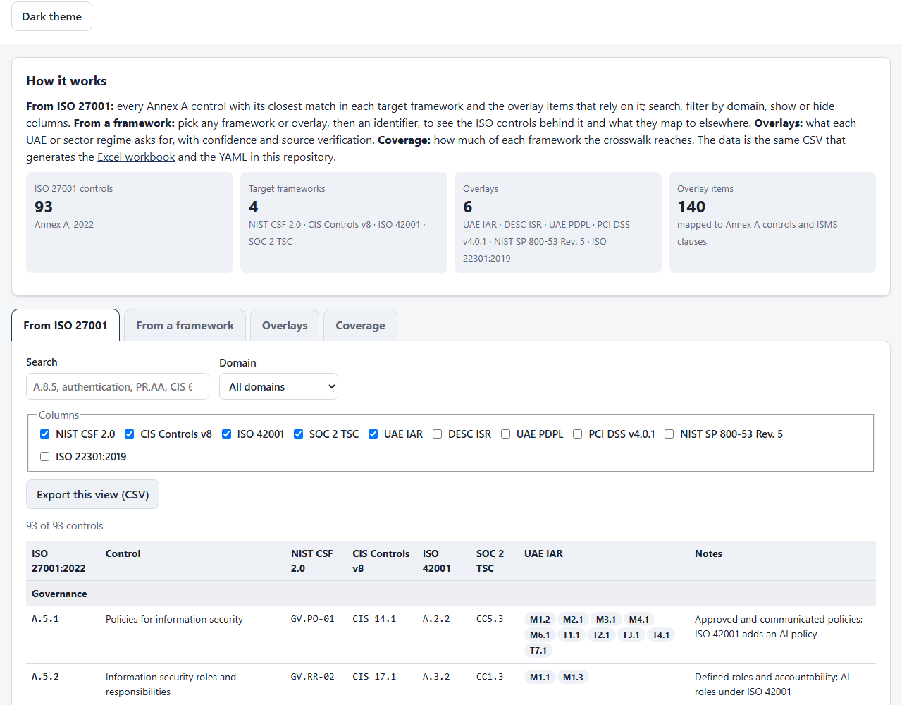

# GRC Control Crosswalk

[](LICENSE) [](https://github.com/bizidwassim-design/grc-control-crosswalk/actions/workflows/ci.yml) [](SECURITY.md) [](https://bizidwassim-design.github.io/grc-control-crosswalk/) [](SECURITY.md)

A free, open-source mapping between the controls of the frameworks most security teams juggle at once, with
UAE and sector overlays (UAE IAR, DESC ISR, UAE PDPL, PCI DSS v4.0.1, NIST SP 800-53 Rev. 5, ISO 22301):

| Source | → Target frameworks | → Overlays |
|--------|---------------------|------------|
| **ISO/IEC 27001:2022** Annex A (93 controls) | **NIST CSF 2.0** (subcategories) · **CIS Controls v8** (safeguards) · **ISO/IEC 42001:2023** Annex A · **SOC 2** Trust Services Criteria | **UAE IAR** · **DESC ISR** · **UAE PDPL** · **PCI DSS v4.0.1** · **NIST SP 800-53 Rev. 5** · **ISO 22301:2019** — see [UAE and sector overlays](#uae-and-sector-overlays) |

Use it to run a gap analysis, reuse evidence across audits, or build a single internal control library instead of five.

**Explore it online:** [bizidwassim-design.github.io/grc-control-crosswalk](https://bizidwassim-design.github.io/grc-control-crosswalk/)
(search any control or identifier, start from any framework or overlay, export the view as CSV; one static page, nothing leaves your browser).



> 🇫🇷 Résumé en français en bas de page.

## Formats

| File | What it is |
|------|------------|
| [`data/crosswalk.csv`](data/crosswalk.csv) | **Source of truth.** One row per ISO 27001 control, with its closest match in each target framework and a short note. |
| [`data/overlays/*.csv`](data/overlays/) | **Source of truth for the overlays.** One row per overlay item (IAR sub-family, ISR domain, PDPL obligation, PCI requirement, 800-53 family, ISO 22301 clause) → Annex A controls and ISMS clauses, with `confidence` and `verification`. |
| [`data/crosswalk.yaml`](data/crosswalk.yaml) | Same content as structured YAML — easy to load in scripts, GRC tools or a policy-as-code pipeline. Each control also lists the overlay items that reference it. |
| [`data/iso27001-overlays.csv`](data/iso27001-overlays.csv) | Each ISO 27001 control → the overlay identifiers that rely on it. |
| [`data/by-framework/*.csv`](data/by-framework/) | Reverse views: each NIST / CIS / ISO 42001 / SOC 2 identifier and each overlay item → the ISO 27001 controls that map to it. |
| [`index.html`](index.html), `assets/`, [`data/crosswalk.js`](data/crosswalk.js) | **Web explorer** (generated data file, strict Content-Security-Policy, no external resources): from ISO 27001, from any framework or overlay, overlay tables, coverage. |
| [`GRC-Control-Crosswalk.xlsx`](GRC-Control-Crosswalk.xlsx) | Excel workbook: overview, full crosswalk with filters, ISO → overlays, one reverse sheet per target framework (`by_*`) and per overlay (`ov_*`). |

Everything except the CSVs in `data/crosswalk.csv` and `data/overlays/` is generated by [`scripts/build_crosswalk.py`](scripts/build_crosswalk.py) (and `data/crosswalk.js` by [`scripts/build_web_data.py`](scripts/build_web_data.py)).

## How to read a mapping

* Each target cell holds the **single closest equivalent** (same objective, similar scope). Real relationships are many-to-many — the reverse sheets show every ISO control that lands on the same target identifier.
* Granularity: NIST CSF 2.0 at *subcategory* level (`PR.AA-05`), CIS v8 at *safeguard* level (`CIS 6.8`), ISO 42001 at *Annex A control* level (`A.6.2.6`), SOC 2 at *criterion* level (`CC6.1`).
* The `notes` column records the reasoning or a caveat (for example where ISO 42001 adds an AI-specific angle).

### Example

| ISO 27001:2022 | NIST CSF 2.0 | CIS v8 | ISO 42001 | SOC 2 |
|----------------|--------------|--------|-----------|-------|
| A.8.5 Secure authentication | PR.AA-03 | CIS 6.3 | A.4.5 | CC6.1 |
| A.8.8 Management of technical vulnerabilities | ID.RA-01 | CIS 7.1 | A.6.2.6 | CC7.1 |
| A.5.23 Information security for use of cloud services | GV.SC-04 | CIS 15.1 | A.10.3 | CC9.2 |

## UAE and sector overlays

Overlays show what each regulation or sector standard asks for, and which ISO/IEC 27001:2022 Annex A controls
(and ISMS clauses 4–10) already cover it. They help an organisation that runs an ISO 27001 ISMS to plan for
UAE regulation, card-payment requirements or a business continuity programme without starting from scratch.

| Overlay | Edition used | Rows | Granularity | Verification |
|---------|--------------|-----:|-------------|--------------|
| [UAE Information Assurance Regulation](data/by-framework/uae_iar.csv) (TDRA) | v1.1, March 2020 | 66 | sub-family M1.1 … T9.3, with IAR P1–P4 priorities | verified |
| [Dubai Information Security Regulation](data/by-framework/desc_isr.csv) (DESC) | ISR version 3 domain structure | 13 | domain | unverified — DESC provides the text on request only |
| [UAE PDPL](data/by-framework/uae_pdpl.csv) (Federal Decree-Law No. 45 of 2021) | as enacted | 12 | obligation, with article numbers | secondary |
| [PCI DSS](data/by-framework/pci_dss_4.csv) | v4.0.1, June 2024 | 12 | principal requirement | verified |
| [NIST SP 800-53](data/by-framework/nist_800_53.csv) | Rev. 5 | 20 | control family | verified |
| [ISO 22301](data/by-framework/iso22301.csv) | 2019 | 17 | clause / sub-clause (BCM) | verified |

* `confidence`: **high** = same objective and scope; **medium** = partial overlap, or the overlay item adds
  requirements ISO 27001 does not have (explained in `notes`).
* `verification`: **verified** = identifier and title checked against the publisher's public text; **secondary** =
  checked against a published translation or reputable secondary sources; **unverified** = the publisher's text is
  not public. Every source, with URL and access date, is in [docs/sources.md](docs/sources.md).
* **UAE PDPL:** enforcement details (for example breach-notification deadlines) depend on the Executive
  Regulations, whose status was unclear at the time of writing. DIFC and ADGM have their own data protection
  regimes. **Check the current status before relying on this overlay.**

Further reading:

* [docs/uae-readiness.md](docs/uae-readiness.md) — what an ISO 27001 organisation must add for IAR, DESC ISR,
  PCI DSS v4.0.1 and PDPL, and the five most common gaps.
* [examples/uae-iar-gap-assessment-contoso-logistics.md](examples/uae-iar-gap-assessment-contoso-logistics.md) —
  a sample IAR gap assessment of a **fictional** company.

> **Overlay disclaimer.** The overlays are informative expert-judgement mappings. They are **not legal advice**,
> not an official mapping by TDRA, DESC, the UAE Data Office, the PCI SSC, NIST or ISO, and not a substitute for
> the current official texts. Identifiers and short titles only; no standard or regulation text is reproduced.

## Using it

```python
import yaml
data = yaml.safe_load(open("data/crosswalk.yaml", encoding="utf-8"))
for c in data["controls"]:
    if c["maps_to"]["nist_csf_2"].startswith("PR.AA"):
        print(c["iso27001_2022"], c["title"])
```

```python
# Which UAE IAR sub-families does each ISO control support?
for c in data["controls"]:
    if c["overlays"]["uae_iar"]:
        print(c["iso27001_2022"], ", ".join(c["overlays"]["uae_iar"]))

# IAR P1 sub-families and the ISO controls behind them
for item in data["overlays"]["uae_iar"]["items"]:
    if "P1" in item["priority"]:
        print(item["ref"], item["title"], item["iso27001_2022"])
```

Or open the Excel workbook and filter `01_Crosswalk` by domain, use a `by_*` sheet to go from a target framework back to ISO 27001, or an `ov_*` sheet for an overlay.

### Rebuilding the outputs

```bash
pip install openpyxl pyyaml
python scripts/validate_crosswalk.py   # same check CI runs
python scripts/build_crosswalk.py
```

The build validates the sources before writing anything: the crosswalk must contain exactly the 93 Annex A controls,
and every overlay row must have a unique, non-empty identifier and reference only existing Annex A controls and
ISO 27001:2022 clauses. The workbook is written with fixed timestamps, so rebuilding unchanged data with the same library versions gives identical files.

## Contributing a mapping change

Edit **only** `data/crosswalk.csv` or a file in `data/overlays/`, regenerate, and open a pull request. In the PR, quote the clause or control text that justifies the new mapping. See [CONTRIBUTING.md](CONTRIBUTING.md).

Good contributions: a better single match, a note explaining a partial match, an additional target framework (add a column in the CSV and an entry in `FRAMEWORKS` in the script), or a new overlay (add `data/overlays/<key>.csv` and register it in `OVERLAYS` in `scripts/validate_crosswalk.py`).

## Disclaimer

Best-effort equivalences for planning and gap analysis. This is **not** an official mapping from any standards body and does not replace reading the standards. Control identifiers are used under nominative fair use; the standards' text itself is not reproduced. Verify against the current editions before relying on this for a certification audit.

## License

[MIT](LICENSE).

---

## 🇫🇷 Résumé

Table de correspondance open source entre les contrôles **ISO/IEC 27001:2022** (Annexe A, 93 contrôles) et leurs équivalents
les plus proches dans **NIST CSF 2.0**, **CIS Controls v8**, **ISO/IEC 42001:2023** et les critères **SOC 2**.
Disponible en CSV (source de vérité), YAML, CSV inversés par référentiel et classeur Excel, le tout généré par un script Python.
Usage : analyse d'écarts, réutilisation des preuves entre audits, bibliothèque de contrôles unifiée.
Surcouches EAU et sectorielles : UAE IAR (TDRA), DESC ISR (Dubaï), loi fédérale PDPL n° 45 de 2021, PCI DSS v4.0.1,
NIST SP 800-53 Rév. 5 et ISO 22301:2019, avec niveau de confiance et statut de vérification des sources.
Correspondances indicatives — pas une interprétation officielle ni un avis juridique. Licence MIT.
